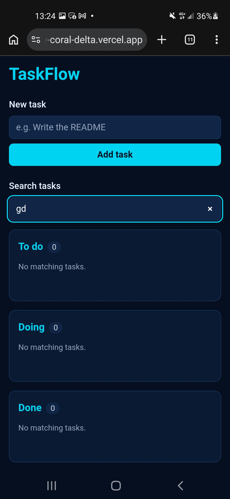

# TaskFlow

An accessible task board built with Next.js, TypeScript and Tailwind. Three columns (To do, Doing, Done), drag and drop that works with a keyboard and screen reader, and tasks that persist in the browser.

**Live:** https://taskflow-coral-delta.vercel.app
**Repo:** https://github.com/Haez0004/taskflow-





## Features

- Add, edit, delete and move tasks between three columns
- Drag and drop with dnd-kit, plus move buttons as a non-drag fallback
- Search to filter tasks, with task counts and empty states per column
- Tasks saved to localStorage, loaded safely after mount (no hydration mismatch)
- Responsive layout, navy and cyan theme

## Accessibility

- Full keyboard support, including dragging with Space and the arrow keys
- Screen reader announcements while dragging, and when tasks are added or deleted
- Visible focus rings, labelled buttons, and focus moved to the column heading after a delete
- Form errors announced with `role="alert"`
- Lighthouse: 100 Accessibility, 100 Best Practices, 100 SEO, 99 to 100 Performance

## Tech stack

Next.js 16, React 19, TypeScript, Tailwind CSS 4, dnd-kit, Vitest

## Run locally

```bash
npm install
npm run dev
npm run lint
npm test
```

## What I learned

- Managing state with `useReducer` and Context, with the reducer as the single place that changes tasks
- Why reading localStorage during the first render causes hydration errors, and how loading in an effect avoids it
- Making drag and drop usable without a mouse: keyboard sensor, announcements and focus management
